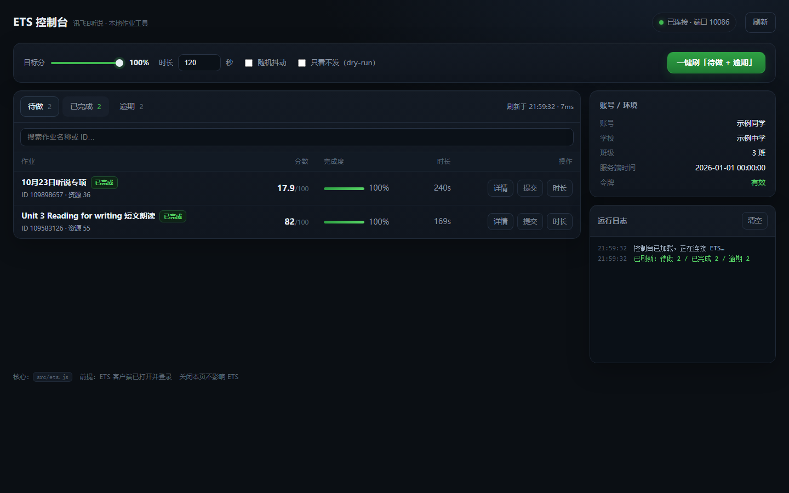

# ETS 控制台（讯飞 E 听说 · 本地作业工具）

> 仓库：<https://github.com/liushuchang-2012/ets-console> · v1.0.0

把「讯飞 E 听说」PC 客户端的作业列表搬进浏览器：查看作业、看结构、提交、改学习时长。
核心是一个零依赖 CLI（`src/ets.js`）加一个零依赖本地 Web 控制台（`webui/`）。



> **免责声明**：本项目仅用于**本人在自己账号上**的学习/研究用途。它不会破解签名算法，也不会伪造登录；
> 它只是复用客户端自己已经打开的调试端口与签名插件。使用产生的账号风险由使用者自负，请勿用于他人账号。

---

## 功能

- 三个列表：**待做 / 已完成 / 逾期**，带服务端真实计数
- 作业详情：分数、完成度、时长、通过线、`item` 明细、资源 set/entity、原始 JSON
- 一键提交（默认 100%），支持 `dry-run` 预览、目标分百分比、时长、随机抖动
- 单独改学习时长
- 批量刷「待做 + 逾期」一次跑完
- 命令行走同一套逻辑，方便脚本化

## 环境要求

| 项目 | 要求 |
| --- | --- |
| 系统 | Windows 10 / 11（客户端只有 Windows 版） |
| Node.js | **18+**，推荐 22 或 24 |
| 客户端 | 讯飞 E 听说 PC 版（本项目在 **5.7.9** 上验证），**必须已登录** |

不需要安装任何 npm 依赖。

## 快速开始

1. 打开「讯飞 E 听说」并登录，进到主页即可（不用停在某个作业里）。
2. 双击 **`启动控制台.bat`**。
   它会自动找 Node、启动本地服务、打开浏览器：<http://127.0.0.1:5173>
3. 页面上选作业、点「提交」。

> 双击没反应时：看黑窗口里的提示。找不到 Node 会明确告诉你；端口被占用会自动复用已在运行的那个。

### 命令行用法

```bash
node src/ets.js doctor                 # 诊断：有没有找到 ETS、调试端口、Node 版本
node src/ets.js status                 # 连接/登录状态、账号信息
node src/ets.js list                   # 三类作业汇总
node src/ets.js show 109583126 --rid 55
node src/ets.js do 109583126 --rid 55 --time 120      # 提交（默认 100%）
node src/ets.js do 109583126 --pct 92 --time 120      # 只要 92%
node src/ets.js do 109583126 --dry                    # 只看不发
node src/ets.js do --todo --time 120                  # 待做 + 逾期全刷
node src/ets.js time 109583126 3600                   # 只改学习时长
```

`do` 的选项：`--pct`（目标分百分比，默认 100）、`--time`（学习时长秒数，默认 120）、
`--dry`（预览）、`--soft`（满分附近留一点随机抖动）、`--force`（已完成也重提，通常没用，见下）。

## 它是怎么工作的（一句话版）

客户端是 CEF（Chromium）壳，发布版把 DevTools 端口留在本机；页面里又暴露了原生签名插件 `EtsHelper`。
所以本工具 = **连上这个端口 → 在页面里调用客户端自己的签名函数 → 用页面 XHR 调业务接口**。
签名算法、密钥、加密都不需要逆向。

详细协议与字段说明见 [docs/PROTOCOL.md](docs/PROTOCOL.md)。

## 跨机器兼容

不同人的安装位置、端口都不一样，工具按下面顺序自动定位：

1. 命令行 `--ets-dir "D:\你的\ETS"`（优先级最高）
2. 环境变量 `ETS_DIR`
3. 正在运行的 `ETSShell.exe` 进程路径
4. 注册表卸载项（DisplayName 含「E听说 / E-Listening / ETS」的 InstallLocation）
5. 常见路径：`%ProgramFiles%\ETS`、`%LOCALAPPDATA%\Programs\ETS`、各盘符 `\ETS` / `\Program Files\ETS` / `\AppGallery\ETS`

端口从 `<ETS目录>\temp\Cache_ETSShell\DevToolsActivePort` 读取；没有该文件就在 `10086–10106` 之间扫。
先跑 `node src/ets.js doctor` 能看到最终解析结果。

## 常见问题

**「没连上 ETS 的调试端口」**
先把客户端打开并登录；还不行重启一次客户端。装了非默认路径就加 `--ets-dir`。用 `doctor` 看解析到哪。

**「已连接 · 未登录」**
客户端里还没登录，或登录态过期。回客户端登录后点刷新。

**提交后能不能改分？**
不能。服务端在作业**首次完成**时把分数冻结（`is_update=0`）。所以本工具只对「还没交过」的作业有意义。

**为什么有的作业提交失败（9001 / plat_data 为空）？**
旧版作业没有 `plat_data`（拿不到 `item_id`），新协议要求 item 维度，这类历史作业无解；工具会在日志里明确标出。

**会不会被检测出来？**
见 `docs/PROTOCOL.md` 的「风险与痕迹」一节：服务端能看到的痕迹包括 `seq_id`、`complete_count`、`submit_time`，
以及「没有音频也给了分」这件事本身。自己判断要不要用。

## 目录结构

```
ets-tool/
├─ 启动控制台.bat        # 双击启动（Windows）
├─ src/ets.js            # 核心 CLI：定位 ETS、签名、接口调用、提交逻辑
├─ webui/
│  ├─ server.js          # 本地 HTTP 服务（0 依赖），把 CLI 包成 JSON API
│  └─ index.html         # 单文件前端（内联 CSS/JS，不联网）
├─ docs/PROTOCOL.md      # 协议与风控实测记录
├─ docs/PUBLISH.md       # 发布到 GitHub 的步骤
├─ 发布到GitHub.bat      # 一键推送脚本（需先建空仓库）
└─ screenshot/           # 界面截图
```

## 开发

```bash
node src/ets.js doctor            # 环境自检
node webui/server.js --open       # 起控制台
ETS_MOCK=1 node webui/server.js   # 演示模式：不连 ETS，返回假数据（看界面用）
PORT=5200 node webui/server.js    # 换端口
```

## 免责声明

本项目为个人学习与研究用途的互操作性工具，不包含任何破解、密钥或账号数据。
使用者需自行承担使用风险，并遵守软件许可协议与所在学校/机构的规定。
本项目与讯飞、E 听说官方无任何关联。

## License

[MIT](LICENSE) · 仅供学习研究，风险自负。
